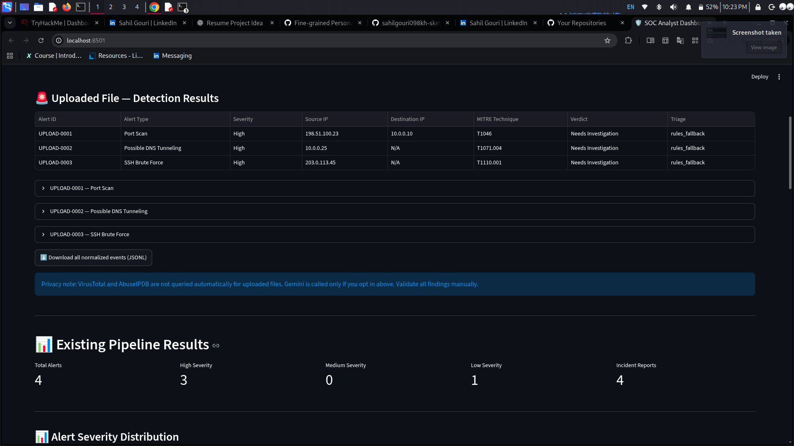
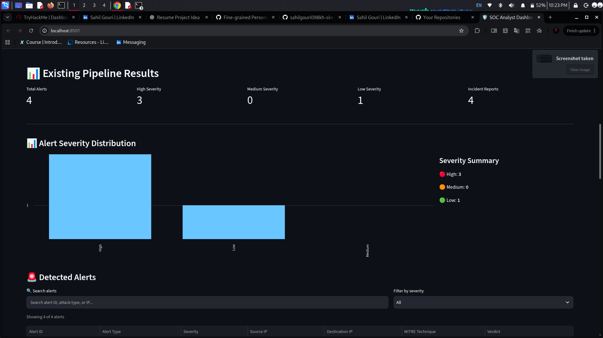
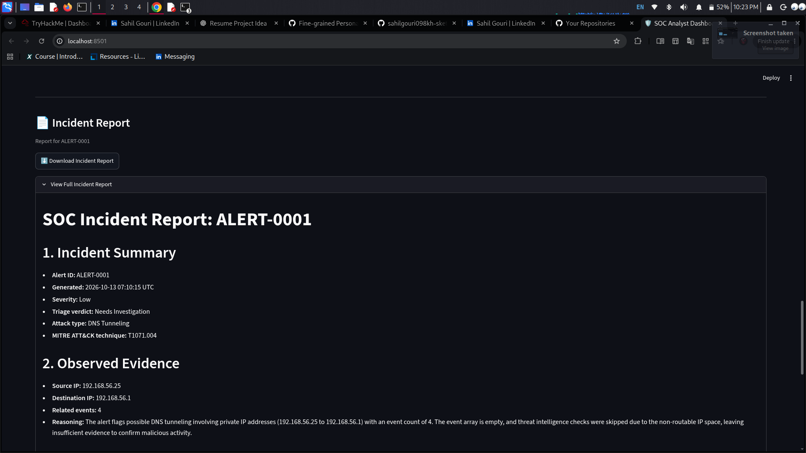
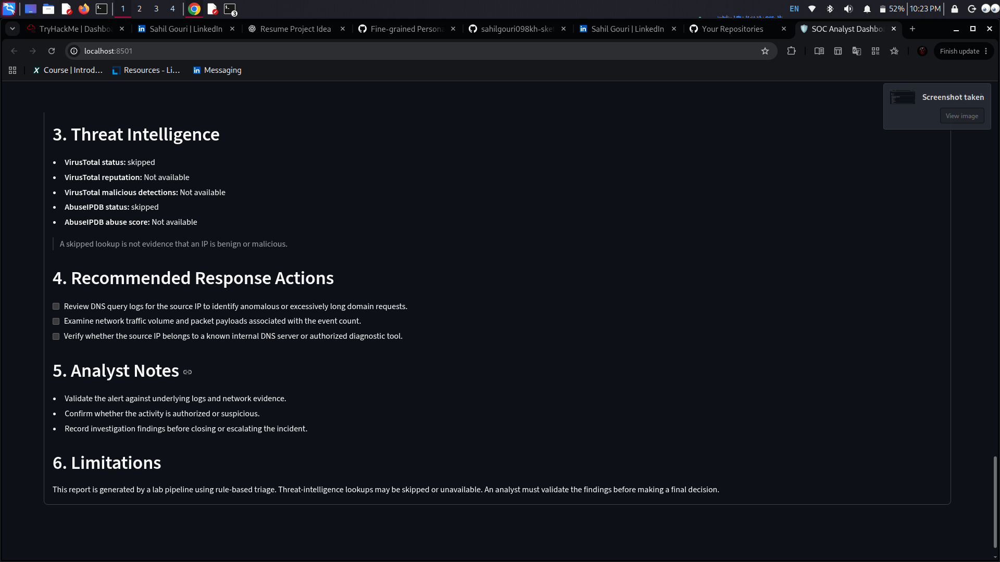

# AI-Powered SOC Analyst Pipeline with Automated Incident Reporting

A Python-based Security Operations Center (SOC) project that simulates security events, detects suspicious activity, enriches alerts with threat intelligence, uses Google Gemini for AI-assisted triage, and generates incident reports.

## Project Overview

This project demonstrates a simplified SOC workflow, from security log collection to alert detection, investigation support, and incident reporting. It is designed for cybersecurity learning and blue-team portfolio development.

## Key Features

- **Security Log Generation:** Generate simulated security events for analysis.
- **Log Parsing:** Normalize generated logs into a consistent format.
- **Detection Engine:** Identify suspicious patterns, including SSH brute-force attempts, port scanning, and possible DNS tunneling.
- **Alert Management:** Group related alerts and enrich them with contextual information.
- **AI-Assisted Triage:** Use Google Gemini to help classify alerts, assess severity, and recommend investigation steps.
- **Threat Intelligence:** Integrate VirusTotal and AbuseIPDB API lookups when applicable.
- **Incident Reporting:** Generate Markdown incident reports.
- **SOC Dashboard:** View alerts and access incident reports through a Streamlit dashboard.
- **Upload & Analyze:** Upload `.log`, `.txt`, `.json`, `.jsonl`, `.ndjson`, or `.csv` files in the dashboard and view results immediately.
- **Privacy-conscious upload workflow:** Uploaded files are analyzed in memory and are not written to disk by the dashboard. Gemini analysis is opt-in; VirusTotal and AbuseIPDB lookups are not automatically run for uploaded logs.

## Architecture

```text
Simulated Security Events
          |
          v
    Log Generator
          |
          v
      Log Parser
          |
          v
   Detection Engine
          |
          v
    Alert Manager
          |
          v
   Threat Intelligence
          |
          v
   Gemini AI Triage
          |
          v
   Incident Reporting
          |
          v
    Streamlit Dashboard
```

## Technology Stack

- Python
- Google Gemini API (`google-genai`)
- Streamlit
- REST APIs
- VirusTotal and AbuseIPDB
- JSONL and Markdown
- Git and GitHub

## Uploaded Log File Support

The dashboard supports JSON/JSONL events, CSV records, and common Linux SSH authentication log lines in `.log` or `.txt` files. The parser maps common field names into the pipeline's normalized event structure.

Current detections include heuristic checks for:
- SSH brute-force patterns (five or more failed SSH logins from one source IP)
- Port-scan records with more than 100 ports reported
- Long DNS TXT queries (query length over 50 characters)

This is not a universal parser for every vendor's log format. Windows EVTX, raw Sysmon XML, arbitrary firewall formats, and other vendor-specific formats may require format-specific parsing and field mapping. A result with no alerts does not mean a file is clean.

For privacy, the uploaded file is not saved to disk by the dashboard. By default, uploaded evidence stays local; checking the Gemini option sends alert metadata and selected event evidence to Google's Gemini API. External VirusTotal and AbuseIPDB lookups are not automatically performed for uploaded logs.

## Detection Scenarios

The pipeline includes simulated detection logic for:

- SSH brute-force activity
- Port scanning
- Potential DNS tunneling

Detection results are heuristic and require validation before being treated as confirmed incidents.

## Setup and Installation

### 1. Clone the repository

```bash
git clone <YOUR_GITHUB_REPOSITORY_URL>
cd ai-soc-pipeline
```

Replace the placeholder with your repository URL.

### 2. Create and activate a virtual environment

```bash
python3 -m venv .venv
source .venv/bin/activate
```

### 3. Install dependencies

```bash
pip install -r requirements.txt
```

### 4. Configure environment variables

Create your local `.env` file:

```bash
cp .env.example .env
```

Add your API keys to `.env` as needed:

```text
GEMINI_API_KEY=your_gemini_api_key
VIRUSTOTAL_API_KEY=your_virustotal_api_key
ABUSEIPDB_API_KEY=your_abuseipdb_api_key
```

Never commit `.env` or publish API keys.

## Run the Pipeline

Run these commands from the project root in the following order:

```bash
python -m src.log_generator
python -m src.log_parser
python -m src.detection_engine
python -m src.alert_manager
python -m src.threat_intel.threat_intel_manager
python -m src.ai_triage
python -m src.incident_report
```

Start the dashboard:

```bash
streamlit run src/dashboard.py
```

## Important Notes

- This project is intended for educational use and local testing.
- Gemini API access, quota, and network connectivity may affect AI triage.
- Threat-intelligence lookups depend on valid API credentials and provider availability.
- A triage verdict is an investigation aid, not proof that an alert is a true positive or false positive.
- Detection rules and integrations have not been validated for production SOC use.

## Learning Outcomes

- Security log parsing and normalization
- Detection engineering fundamentals
- Alert correlation and triage
- Threat intelligence integration
- AI-assisted security analysis
- Incident documentation and reporting
- Building a basic blue-team workflow


## Author

**Sahil Gouri**
Cybersecurity Learner | Aspiring SOC Analyst | Blue Team

- **LinkedIn:** [linkedin.com/in/sahil-gouri-569b483a7](https://www.linkedin.com/in/sahil-gouri-569b483a7)
- **GitHub:** [sahilgouri098kh-sketch](https://github.com/sahilgouri098kh-sketch)

Focused on SOC operations, security monitoring, detection engineering, threat intelligence, and incident response.


## Project Screenshots

### SOC Dashboard


### Security Event Analysis


### Alert Detection Results


### Test Results

